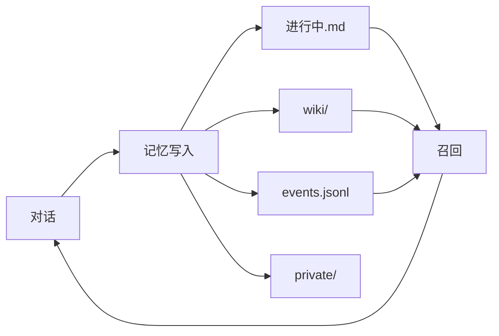

# 高级指南 · 1 天搭骨架

日期：2026-11-15
背景与来源：基于爱玩社区《AI 原生新人类·装机包 v1》的高级路径改写。
结论：用 Claude Code + git + 事件流 + 沉淀日报 + 自检器，搭一个可审计、可迭代的外脑；先搭骨架，2–3 周再扩展。

## 适合谁

- 你会终端和 git。
- 你想要自动化、记忆分层、自检、事件留痕。
- 你愿意先花 1 天搭骨架，再用 2–3 周跑顺。
- 你能接受“先跑通，再加功能”。

## 你会得到

- 完整目录：宪法、工作台、`wiki/`、`private/`、`events.jsonl`、`skills/`、`reports/`
- 记忆分层：常驻锚 / 会话上下文 / 私有层
- 事件流：写入 / 召回 / 纠正 / 冲突 / 过期清理
- 沉淀日报：每天“记了什么”见光
- 自检器：每周检查结构、看板、垃圾、红线、内化
- 定时任务：手动跑通后再挂 cron / launchd

## 架构



## 第 1 天：搭骨架

### 1. 建库

```bash
mkdir my-brain
cd my-brain
git init
```

`.gitignore`：

```text
private/*
!private/.gitkeep
reports/
node_modules/
```

### 2. 立宪法 + 工作台

- 复制 `AGENTS.md`、`进行中.md`。
- 建 `wiki/`、`private/`、`skills/`、`reports/`。
- 宪法里的 Q1–Q3 必须由主人亲自填。

### 3. 配权限

- 复制 `templates/settings.json` 到 `.claude/settings.json`。
- 验证“建文件不弹、删文件弹”。
- 红线：删除、出网、库外写、读凭证，永远要问。

### 4. 事件流

建 `events.jsonl`，一行一个 JSON，只追加、不改写历史。

字段：

| 字段 | 含义 | 示例 |
| --- | --- | --- |
| `time` | 时间 | `2026-11-15T10:00:00+08:00` |
| `event` | 类型 | 写入 / 召回 / 纠正 / 冲突 / 过期清理 |
| `source` | 来源 | `wiki/面试复盘.md` |
| `query` | 本次操作 | “整理第 2 场面试” |
| `recalled` | 召回条目 | `["wiki/面试复盘.md"]` |
| `verdict` | 结果 | 成功 / 命中 / 已纠正 |
| `tag` | 标签 | `面试复盘` |

规则：

- 每次写入/召回/纠正/冲突/清理，都追加一条。
- 不改旧行；要修正就追加“纠正”事件。
- `private/` 只记目录级摘要，不写文件名/内容。

### 5. 沉淀日报

```bash
python3 tools/deposit_report.py --write
```

每天生成 `reports/YYYY-MM-DD.md`：今天改了什么、git 状态、需要确认什么。  
没有 Python 就手动复制 `templates/日报模板.md`。

### 6. 自检器

每周一次，只读检查：

- **结构**：根目录有没有散落文件；`wiki/`、`private/`、`进行中.md` 是否都在。
- **看板**：进行中超过 7 天没更新的任务；完成但没归档的。
- **垃圾**：`.bak`、重复文件、空文件。
- **红线**：`private/` 是否被 git 跟踪；是否被核心文件引用。
- **内化**：这周有没有跳过“先想三行”；AI 答错的有没有进 `wiki/判断记录/`。

输出一份 `wiki/自检/YYYY-MM-DD.md`，只列建议，不自动改。

### 7. 定时任务

- 先用 `templates/settings.json` 配好权限。
- **手动跑通一次**沉淀日报。
- 再挂定时（macOS launchd / cron）。
- 定时命令里不要用“全部放行”开关；失败留日志，不要静默放行。

### 8. 记忆分层

- **常驻锚**：`AGENTS.md` + 当前最重要的事 + 1–3 个项目。
- **会话上下文**：本次对话相关的工作台/知识页。
- **私有层**：`private/`，永不出本机。
- 召回时先读常驻锚，再按需读会话上下文；私有层不读。

## 第 2–3 周：跑顺

- 每天 10 分钟：一个真实任务，更新工作台。
- 每周 30 分钟：周复盘 + 自检。
- 只加一个自动化：沉淀日报或自检器，别同时加。
- 两周后如果循环稳定，再考虑检索/向量库。

## 验收：五个信号

1. 事件流有 20 条以上真实记录（不是演示）。
2. 用外脑做成过 3 件真事。
3. 有一份周自检报告。
4. 没有静默写入；每次写入你都知道。
5. 你能用自己的话解释：外脑记了什么、为什么记、什么时候该忘。

## 常见错误

- **先自动化，后跑循环**：任务失败你还不知道。
- **技能/插件太多**：维护成本吃掉收益。
- **没有隐私层**：一次同步，全部公开。
- **没有评测**：不知道召回准不准。
- **过度工程**：向量库/多 Agent 不是第一天的必需品。

## 下一步

- 给事件流加评测：召回命中率、归档准确率、静默写入=0。
- 给 `wiki/` 加检索：先关键词，再考虑向量。
- 给自检加风险雷达：任务卡住、投递无进展、知识长期不复习。

**可靠性只来自在跑的机制，不来自文档里的决心。**
